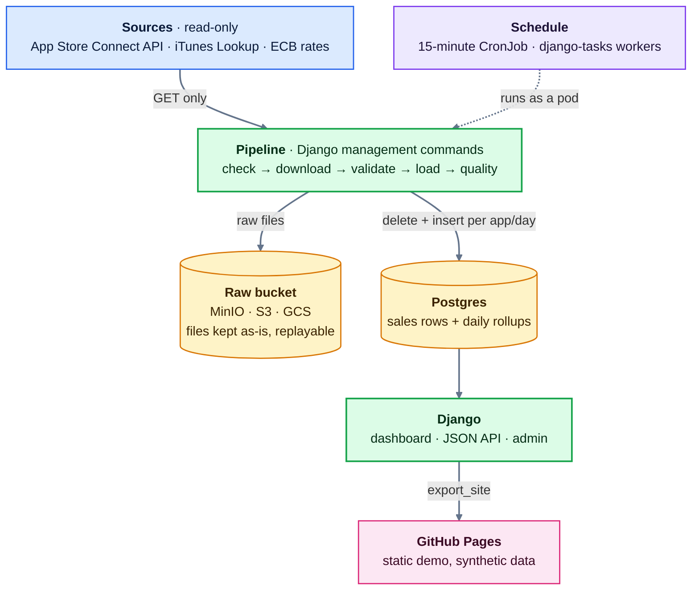

# ASCStats

A small, production-shaped data pipeline that pulls App Store Connect reports for my own
iOS apps into Postgres and serves them through Django.

- **Ingest**: a minimal, read-only App Store Connect client (ES256 JWT, JSON:API paging,
  retries on GET only) fetches Sales & Trends daily summaries and Analytics Reports.
- **Land**: raw report files go unchanged into an S3-compatible bucket (MinIO locally).
- **Load**: sales lines are stored as they are and every report is map-reduced at load time:
  per-report emitters turn each parsed line into `(table, key, counts)`, a reducer sums them,
  and only the sums reach Postgres (`SalesDay`, `FunnelDay`, `UsageDay`), with an idempotent
  delete+insert per `(app, date)` in one transaction. The raw files stay in the bucket, so a
  new question is a new emitter plus a replay of the load step. Every attempt is logged.
- **Analyse**: every release is dated from the sales data and compared with the days before
  it (downloads, in-app purchases, conversion), with a t-score so noise is not read as a win.
- **Revenue**: developer proceeds from every storefront, converted to USD at daily European
  Central Bank reference rates (`import_fx`), on a `/revenue` page: weekly proceeds by app,
  apps at a glance, top sellers and storefronts.
- **Funnel**: impressions -> page views -> downloads -> in-app purchases at the bottom of each
  app's Stats tab: the app's conversion, where it leaks against its own usual rate (downloads
  lost a month), weekly step rates with releases, and source mix next to each source's rate.
  The headline is downloads / unique impressions (search downloads skip the product page, so
  downloads / page views can pass 100%); every rate is a ratio of sums with a 90% interval,
  shrunk toward the portfolio, and gaps stay gaps.
- **Ratings**: Apple publishes only today's star-rating totals (public iTunes Lookup), so a
  daily snapshot builds the history, and the difference of two snapshots gives the exact count
  and average of the ratings in between. Written reviews and Apple's review summaries come from
  App Store Connect, each filed under the version it was written for; per-version ratings are
  at `/api/apps/{apple_id}/ratings`.
- **Competitors and keywords** (the `aso` app): up to 10 competitors per app, added by App
  Store link or ID (`add_competitor`, or the app's Competitors tab). They ride in the same
  daily Lookup requests as your own apps, so following them costs no extra calls; their tab
  compares ratings, recent ratings, new ratings per week and releases with their notes. Up to
  150 keywords per app (`add_keyword`, or the Keywords tab), each searched once a day with
  iTunes Search, top 200; the whole result order is kept, so your rank and every
  competitor's come from the same searches. The public Search API's order follows the App
  Store's own closely but not exactly. Each keyword also gets scores, 0-100
  (`aso/scoring.py`): difficulty from the top 10 (rating strength, titles aiming at the
  term), popularity from a fitted App Store model (the first 25 results plus a weekly
  look at the store's search suggestions, `probe_suggestions`), and opportunity from the two.
  Popularity is an estimate: Apple publishes real search volume only through Apple Ads; the
  tab explains each score in a tip on its column header. Below the ranks, a Suggestions card
  (`aso/finder.py`) asks the store's autocomplete, live, what follows the app's own keywords
  and the phrases two or more of its competitors put in their names, and keeps only terms
  holding a word of the app's name ("spades" for Spades: No Ads), so a seed like "spades
  offline" never offers "offline music". A look asks 12 seeds in a few seconds, a deep look
  40, and each is kept for the day; a term is tracked only when someone presses its Track
  button.
- **Competitors' listing changes**: each day's Lookup listing of a competitor is compared
  with the day before, and every field that changed (name, description, screenshots, price,
  category, seller, languages) is kept as a `ListingChange`. Lookup has no subtitle, so
  `read_subtitles` reads it from the App Store web page: once for each competitor, again
  when it ships a version (a subtitle only changes with one), monthly otherwise, at most 60
  pages a day. The Competitors tab shows the changes as word diffs, screenshots before and
  after, and the words a name or subtitle gained or dropped.
- **Competitors' keywords**: Apple keeps an app's keyword field private, so a scan
  (`aso/rival_keywords.py`, started from the Keywords tab, run by the `store` worker) guesses
  the terms a competitor aims at (phrases in its name and subtitle, the store's suggestions
  for them, phrases its description repeats) and searches each once, about 30 searches,
  reusing any term searched in the last week. The searches are saved like tracked keywords'
  under keywords no app tracks, so tracking one keeps its first day. The Keywords tab's
  "Competitors' keywords" card lists every term searched in the last month where a followed
  competitor ranks in the top 50 and the app doesn't track it, with your rank in the same
  search and a Track button.
- **Serve**: behind a sign-in (only `/api/health` is open), Django admin, a JSON API (Django Ninja, OpenAPI at `/api/docs`) and one
  server-rendered htmx page with a chart.
- **Run**: Docker Compose for development, Kustomize manifests for Kubernetes. Background jobs
  queue in Postgres (django-tasks), one worker per queue, and a schedule run every 15 minutes
  queues whatever is due.

> The repository contains **no real sales numbers**. `seed_synthetic` generates
> deterministic, realistic files in Apple's exact format, and every demo below uses it.

## Architecture



One container image does everything; only the command differs. The unit of work is a single
management command:

```bash
python manage.py import_asc --report sales --date 2026-10-18
python manage.py import_asc --report analytics --date yesterday --app 1000000002
python manage.py import_asc --report sales --date 2026-10-18 --step validate   # one step only
```

| Step       | What it does                                                                                     |
|------------|--------------------------------------------------------------------------------------------------|
| `check`    | Is the report published? (Exit code 3 when not, so schedulers can retry later.)                   |
| `download` | Fetch and write the raw file(s) to the bucket under `sales/date=…/` or `analytics/date=…/app=…/`. |
| `validate` | Parse from the bucket: required columns, types, dates, in-app purchases attributable to an app.  |
| `load`     | One transaction: delete the `(app, report, day)` rows, bulk insert the new ones.                  |
| `quality`  | Postgres must match the raw file exactly: row counts and unit/count totals per app.              |

Steps hand state to each other only through the bucket, so each one can be retried on its
own, and any day can be reloaded from raw without asking Apple again.

### Tables (all owned by Django models and migrations)

| Model              | Notes                                                                                     |
|--------------------|-------------------------------------------------------------------------------------------|
| `App`              | Apple ID, name, SKU, bundle ID, `is_active` (included in imports).                         |
| `SalesRow`         | One line of the SALES/SUMMARY/DAILY report. IAPs attributed via `Parent Identifier`.       |
| `SalesDay`         | Sales rollup per app, day and platform (downloads, redownloads, updates, purchases), emitted at load. |
| `FunnelDay`        | Impressions, page views and downloads per app, day and source, reduced at load from the analytics reports. |
| `UsageDay`         | Sessions and crashes per app, day, platform and app version, reduced at load. |
| `ConversionMetric` | Derived daily funnel: unique impressions, unique page views, first-time downloads, sales downloads, in-app purchases. Rates are computed over windows, never stored. |
| `AppVersion`       | Version dated by first appearance in sales; ASC state and creation time when on real data. |
| `RatingSnapshot`   | Public star-rating totals per app, storefront and day (count and exact star sum).          |
| `CustomerReview`   | A written review from App Store Connect, with the version and platform it was written for. |
| `ReviewSummary`    | Apple's AI-written summary of an app's reviews, per platform and territory.                |
| `Competitor`       | Someone else's app, followed for one or more of yours (`aso`); listing from iTunes Lookup.  |
| `CompetitorSnapshot` | A competitor's public rating totals per storefront and day, like `RatingSnapshot`.       |
| `CompetitorRelease` | A competitor version with Apple's release date and notes, from the day it was first seen. |
| `Keyword`          | A search term in one storefront, tracked for one or more of your apps (`aso`).              |
| `KeywordSnapshot`  | One day's search results for a keyword: every Apple ID in order, and the top 25 by name.    |
| `KeywordSuggestion` | A weekly look at the store's search suggestions for a keyword: how early and how often.   |
| `FxDay`            | One row per day: JSON of currency -> USD per unit (ECB via Frankfurter); as-of lookup on weekends. Apple pays at its own rates, so this is an estimate. |
| `IngestionRun`     | The run log: report, day, app, step, source, status, row counts, error.                   |

### Did that release help?

`build_versions` dates every version by the first day it appears in the sales report (new
downloads and updates carry the version the customer received), and
`GET /api/apps/{apple_id}/versions?window=14` compares each version's first days live with
the days just before it, two ways: naive before/after, and against the trend the app was
already on (a log-linear fit with day-of-week effects on the 28 days before, with a level
shift for any earlier release in that window, projected over the days the version was live):

| Metric                 | Before | After | Change | t     |
|------------------------|-------:|------:|-------:|------:|
| downloads/day          |  276.9 | 223.4 | −19.3% | −3.9  |
| in-app purchases/day   |   11.2 |   7.5 | −33.1% | −2.7  |
| conversion rate        |  0.322 | 0.319 |  −1.1% |       |

(Synthetic Snake 2.1, a −20% regression planted in the generator. The planted +30%, −20%,
+20% and +20% of Snake 2.0, 2.1, 2.2 and 2.3 come back as +30%, −19%, +32% and +21%, all
|t| > 2, while the no-effect 2.0.1 comes back as −2%, t = −0.3.) Windows stop at the neighbouring
releases, so each side contains one version only. It is a before/after comparison, not an
experiment: seasonality, features and marketing land in the same windows, which is why every
delta carries a Welch t-score and the dashboard only bolds |t| ≥ 2. Update rows (product type
`7`/`7F`/`7T`/`F7`) date releases but never count as downloads, and neither do redownloads
(`3`/`3F`/`3T`/`F3`). Mac and iOS share an app record but not version numbers, so versions are
dated and compared per platform, split on the report's `Device` column (`Desktop` is
a Mac; product types are no guide, since iPhone updates arrive as `F7` too).

## Quick start (Docker Compose)

```bash
docker compose up --build -d
docker compose exec web python manage.py seed_synthetic --days 90
docker compose exec web python manage.py createsuperuser
open http://localhost:8000          # sign in as that user; every page and API call needs it
open http://localhost:8000/admin/   # every table, including the run log
open http://localhost:8000/api/docs # OpenAPI
curl localhost:8000/api/apps/1000000002/sales/daily
```

MinIO's console is on http://localhost:9001 (`ascstats` / `ascstats-dev-secret`), where the
raw files are visible under `ascstats-raw/`.

## Static demo (GitHub Pages)

`export_site` renders the synthetic demo as plain files: every page, every period
(`/7d/`, `/revenue/1d/`) and every htmx fragment (`/chart/<app>/<days>/`), each at its own
path with no query strings, under a base path such as `/ASCStats/`. The demo is frozen on
**June 29, 2026** (the iPhone went on sale on June 29, 2007), so it never goes stale.

```bash
ASC_SOURCE=synthetic DATABASE_URL=sqlite:////tmp/demo.sqlite3 \
  uv run python manage.py export_site --out /tmp/site --base-path /ASCStats/
```

It only runs on a fresh synthetic database (it refuses `ASC_SOURCE=asc` or a database with
any apps in it), so real sales can never reach the published files, and it fails if any link
it wrote points at a page it did not write. Exchange rates are the real ECB rates for those
dates. In the demo the header links to the source instead of the API and admin, which need
a server. `.github/workflows/pages.yml` builds and deploys it on every push to `main` once
Pages is set to deploy from GitHub Actions (Settings → Pages → Source).

## Backfill and restatement

```bash
python manage.py import_asc --report sales --from 2026-01-01 --to 2026-03-31
python manage.py import_asc --report analytics --from today-7 --to yesterday
```

Backfill is the same command over a range: each day is independent, so a failed day is
reported and the rest continue (exit code 1 if any day failed, 3 if any were not yet
published). Because every load is a delete+insert of exactly one `(app, report, day)`,
running a day twice gives the same rows: restating the last week is just a re-run.

## Background jobs (and why no Celery or Redis)

Every job is a django-tasks task queued in Postgres (`stats/jobs.py`), and `manage.py
db_worker` runs one worker per queue, so jobs in a queue never overlap: `asc` for everything
that calls App Store Connect, `store` for the public App Store, `default` for the rest.
`manage.py schedule` runs every 15 minutes and queues each job that is due, judging by the
data and the jobs' own results rather than a calendar (`stats/schedule.py`):

- `sales` / `analytics`: each of the last 7 days not imported yet, so a day Apple publishes
  late, or a day the machine was off, is picked up on the next run.
- `derived`: conversion metrics, FX and versions, whenever an import finished since the last.
- `asc_daily` / `store_daily`: once a UTC day from 17:00 (versions and reviews; rating
  totals, keyword searches and search suggestions). Ratings history cannot be backfilled.
- `restatement`: the previous 7 complete days again, Mondays from 18:00.

A failed job is queued again two hours later, a report Apple has not published yet half an
hour later. `SCHEDULED_JOBS` names the jobs the schedule queues.

The queue is the database the app already has: no broker, no second stateful service, and a
job's state sits next to the data it wrote, in the same backups and the same admin.

## Kubernetes (Docker Desktop)

Enable Kubernetes in Docker Desktop (Settings → Kubernetes), then:

```bash
docker build -t ascstats:dev .
kubectl apply -k k8s/
kubectl -n ascstats rollout status deploy/web
kubectl -n ascstats exec deploy/web -- python manage.py seed_synthetic --days 30
open http://localhost:8000
kubectl -n ascstats create job --from=cronjob/schedule schedule-now   # queue what is due now
```

`k8s/` contains: a Postgres StatefulSet, MinIO, the web Deployment (migrations run in an init
container), the two `db_worker` Deployments (`worker` for the `asc` and `default` queues,
`worker-store` for `store`), the `schedule` CronJob every 15 minutes, a `prune-jobs` CronJob
that drops job results older than 30 days, and Secret templates in `k8s/secrets/`. For local convenience Kustomize generates dev-only
Secrets from `k8s/secrets/dev-*.env`; on a shared cluster delete that generator and create
the Secrets from the templates (or External Secrets).

### The App Store Connect key

The `.p8` key is a Kubernetes Secret mounted **as a file** at `/var/run/secrets/asc/AuthKey.p8`
(mode 0440, readable through `fsGroup` only) and read in exactly one place:
`src/ascstats/asc/credentials.py`. It is never an environment variable, so it does not show up
in `kubectl describe`, process listings or crash reports. See
`k8s/secrets/asc-api-key.example.yaml` for the `kubectl create secret` command. The key needs
the Sales (or Finance/Admin) role for Sales & Trends.

Everything runs in synthetic mode until an `asc-settings` Secret switches it over. It overrides
the ConfigMap, so the vendor number never lands in git:

```bash
kubectl -n ascstats create secret generic asc-settings \
  --from-literal=ASC_SOURCE=asc --from-literal=ASC_VENDOR_NUMBER=8xxxxxxx
kubectl -n ascstats rollout restart deploy/web
kubectl -n ascstats exec deploy/web -- python manage.py sync_app_status
```

`sync_app_status` asks App Store Connect once whether each app is on sale: an app with no
version in `READY_FOR_SALE` (a deleted app has none; App Store Connect answers 404) is switched
off (`is_active`), since deleted apps keep appearing in the sales report. Apps the pipeline sees
for the first time are checked the same way when they are created; nothing asks again on later
runs, and an app switched off by hand is never switched back on. A daily analytics import
runs app by app, so an app App Store Connect refuses (403, or 404 for no ONGOING report
request) is skipped with a warning rather than failing the day for the others.

The client cannot write: it has no POST/PATCH/DELETE method at all, and a test asserts that
every recorded request is a GET. The one-time ONGOING Analytics report request is created by
hand in App Store Connect, outside the pipeline.

## Mapping to EKS / GKE

| Here (Docker Desktop)              | EKS                                                         | GKE                                                                    |
|------------------------------------|-------------------------------------------------------------|------------------------------------------------------------------------|
| Postgres StatefulSet               | RDS for PostgreSQL                                          | Cloud SQL for PostgreSQL (Cloud SQL Auth Proxy sidecar)               |
| MinIO                              | S3 bucket; pods get access via IRSA / EKS Pod Identity      | GCS bucket via its S3-interoperability endpoint, or Workload Identity |
| Kustomize-generated dev Secrets    | AWS Secrets Manager + External Secrets Operator             | Secret Manager + External Secrets / Secret Manager CSI driver         |
| `asc-api-key` Secret file mount    | same mount, sourced from Secrets Manager                    | same mount, sourced from Secret Manager                                |
| `web` `LoadBalancer` Service       | AWS Load Balancer Controller Ingress (ALB)                   | GKE Ingress / Gateway                                                  |
| local `ascstats:dev` image         | ECR                                                         | Artifact Registry                                                      |
| CronJobs                           | unchanged                                                   | unchanged                                                              |

Only configuration changes: `DATABASE_URL`, `RAW_STORAGE_URL`/`S3_ENDPOINT_URL`, the image
name in `kustomization.yaml`, and an overlay that drops `minio.yaml`/`postgres.yaml`.

## Development

```bash
uv sync
uv run ruff check && uv run ruff format --check
uv run pytest                 # SQLite by default; set DATABASE_URL for Postgres
```

Tests never touch the network: the ASC client is exercised against recorded JSON:API
responses and report files in `tests/fixtures/asc/` through an `httpx.MockTransport`, covering
JWT claims, pagination, retries with `Retry-After`, 404-as-not-ready and GET-only behaviour.

```
src/ascstats/
  asc/client.py         read-only App Store Connect client
  asc/credentials.py    the only place the .p8 key is read
  store/itunes.py       the public App Store: iTunes Lookup, Search and search hints, keyless
  stats/pipeline.py     check / download / validate / load / quality
  stats/parsing.py      report parsing and validation (pure functions)
  stats/synthetic.py    synthetic reports in Apple's file format
  stats/storage.py      raw landing zone (S3 API or local files)
  stats/ratings.py      rating snapshots, reviews and per-version ratings
  stats/management/commands/  import_asc, seed_synthetic, build_conversion_metrics,
                        build_versions, import_fx, snapshot_ratings, import_reviews,
                        ensure_report_requests, ensure_raw_bucket, list_apps
  stats/extensions.py   hooks other apps register with, so stats never imports them
  aso/                  competitors and keywords (models, daily search, tabs,
                        scoring, keyword suggestions, add_competitor, add_keyword,
                        snapshot_keywords, probe_suggestions)
  api.py                Django Ninja API
k8s/                    Kustomize manifests
```
