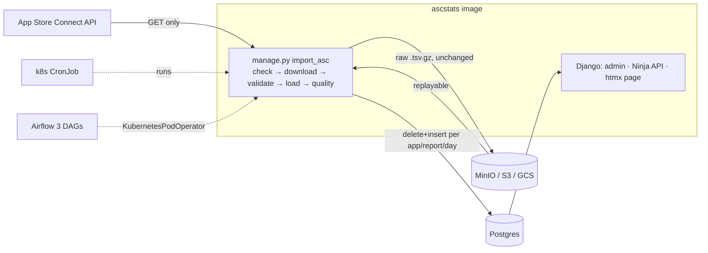

# ASCStats

A small, production-shaped data pipeline that pulls App Store Connect reports for my own
iOS apps into Postgres and serves them through Django.

- **Ingest**: a minimal, read-only App Store Connect client (ES256 JWT, JSON:API paging,
  retries on GET only) fetches Sales & Trends daily summaries and Analytics Reports.
- **Land**: raw report files go unchanged into an S3-compatible bucket (MinIO locally).
- **Load**: validated rows are loaded into Postgres with an idempotent delete+insert per
  `(app, report, date)` in one transaction; every attempt is written to a run log.
- **Analyse**: every release is dated from the sales data and compared with the days before
  it (downloads, in-app purchases, conversion), with a t-score so noise is not read as a win.
- **Serve**: Django admin, a JSON API (Django Ninja, OpenAPI at `/api/docs`) and one
  server-rendered htmx page with a chart.
- **Run**: Docker Compose for development, Kustomize manifests for Kubernetes (a CronJob per
  report), and Airflow 3 DAGs that orchestrate the same container as Kubernetes pods.

> The repository contains **no real sales numbers**. `seed_synthetic` generates
> deterministic, realistic files in Apple's exact format, and every demo below uses it.

## Architecture



One container image does everything; only the command differs. The unit of work is a single
management command:

```bash
python manage.py import_asc --report sales --date 2026-10-18
python manage.py import_asc --report analytics --date yesterday --app 1000000002
python manage.py import_asc --report sales --date 2026-10-18 --step validate   # one step only
```

| Step       | What it does                                                                                     |
|------------|--------------------------------------------------------------------------------------------------|
| `check`    | Is the report published? (Exit code 3 when not, so schedulers can retry later.)                   |
| `download` | Fetch and write the raw file(s) to the bucket under `sales/date=…/` or `analytics/date=…/app=…/`. |
| `validate` | Parse from the bucket: required columns, types, dates, in-app purchases attributable to an app.  |
| `load`     | One transaction: delete the `(app, report, day)` rows, bulk insert the new ones.                  |
| `quality`  | Postgres must match the raw file exactly: row counts and unit/count totals per app.              |

Steps hand state to each other only through the bucket, so each one can be retried on its
own, and any day can be reloaded from raw without asking Apple again.

### Tables (all owned by Django models and migrations)

| Model              | Notes                                                                                     |
|--------------------|-------------------------------------------------------------------------------------------|
| `App`              | Apple ID, name, SKU, bundle ID, `is_active` (included in imports).                         |
| `SalesRow`         | One line of the SALES/SUMMARY/DAILY report. IAPs attributed via `Parent Identifier`.       |
| `AnalyticsRow`     | One line of an Analytics Reports segment; common columns typed, the rest in `dimensions`. |
| `ConversionMetric` | Derived daily funnel: impressions, page views, first-time downloads, units.               |
| `AppVersion`       | Version dated by first appearance in sales; ASC state and creation time when on real data. |
| `IngestionRun`     | The run log: report, day, app, step, source, status, row counts, error.                   |

### Did that release help?

`build_versions` dates every version by the first day it appears in the sales report (new
downloads and updates carry the version the customer received), and
`GET /api/apps/{apple_id}/versions?window=14` compares each version's first days live with
the days just before it:

| Metric                 | Before | After | Change | t     |
|------------------------|-------:|------:|-------:|------:|
| downloads/day          |  276.9 | 223.4 | −19.3% | −3.9  |
| in-app purchases/day   |   11.2 |   7.5 | −33.1% | −2.7  |
| conversion rate        |  0.322 | 0.319 |  −1.1% |       |

(Synthetic Snake 2.1, a −20% regression planted in the generator. The planted +30%, −20%,
+20% and +20% of Snake 2.0, 2.1, 2.2 and 2.3 come back as +30%, −19%, +32% and +21%, all
|t| > 2, while the no-effect 2.0.1 comes back as −2%, t = −0.3.) Windows stop at the neighbouring
releases, so each side contains one version only. It is a before/after comparison, not an
experiment: seasonality, features and marketing land in the same windows, which is why every
delta carries a Welch t-score and the dashboard only bolds |t| ≥ 2. Update rows (product type
`7`/`7F`/`7T`/`F7`) date releases but never count as downloads, and neither do redownloads
(`3`/`3F`/`3T`/`F3`). Mac and iOS share an app record but not version numbers, so versions are
dated and compared per platform, split on the report's `Device` column (`Desktop` is
a Mac; product types are no guide, since iPhone updates arrive as `F7` too).

## Quick start (Docker Compose)

```bash
docker compose up --build -d
docker compose exec web python manage.py seed_synthetic --days 90
docker compose exec web python manage.py createsuperuser
open http://localhost:8000          # chart
open http://localhost:8000/admin/   # every table, including the run log
open http://localhost:8000/api/docs # OpenAPI
curl localhost:8000/api/apps/1000000002/sales/daily
```

MinIO's console is on http://localhost:9001 (`ascstats` / `ascstats-dev-secret`), where the
raw files are visible under `ascstats-raw/`.

## Backfill and restatement

```bash
python manage.py import_asc --report sales --from 2026-01-01 --to 2026-03-31
python manage.py import_asc --report analytics --from today-7 --to yesterday
```

Backfill is the same command over a range: each day is independent, so a failed day is
reported and the rest continue (exit code 1 if any day failed, 3 if any were not yet
published). Because every load is a delete+insert of exactly one `(app, report, day)`,
running a day twice gives the same rows: restating the last week is just a re-run. In
Airflow, backfill is `airflow dags backfill` over data intervals (see below).

## Why no Celery (or Redis)

A daily import is a CronJob, not a queue. There is one job per report per day, it takes
seconds, and the only concurrency that matters is "never two imports of the same report at
once", which `concurrencyPolicy: Forbid` gives for free. A broker and a worker fleet would add
two stateful services to operate, a second retry mechanism next to Kubernetes' Job
`backoffLimit`, and a place for work to disappear (an acknowledged-but-lost message), all to
schedule something cron already schedules. When orchestration grows real dependencies
(wait for Apple, fan out over apps, run metrics when both reports land), that is a workflow
problem and Airflow handles it, still launching the same container as a pod.

## Kubernetes (Docker Desktop)

Enable Kubernetes in Docker Desktop (Settings → Kubernetes), then:

```bash
docker build -t ascstats:dev .
kubectl apply -k k8s/
kubectl -n ascstats rollout status deploy/web
kubectl -n ascstats exec deploy/web -- python manage.py seed_synthetic --days 30
open http://localhost:8000
kubectl -n ascstats create job --from=cronjob/import-sales import-sales-now   # run the CronJob once
```

`k8s/` contains: a Postgres StatefulSet, MinIO, the web Deployment (migrations run in an init
container), the `import-sales` and `import-analytics` CronJobs with `concurrencyPolicy: Forbid`,
and Secret templates in `k8s/secrets/`. For local convenience Kustomize generates dev-only
Secrets from `k8s/secrets/dev-*.env`; on a shared cluster delete that generator and create
the Secrets from the templates (or External Secrets).

### The App Store Connect key

The `.p8` key is a Kubernetes Secret mounted **as a file** at `/var/run/secrets/asc/AuthKey.p8`
(mode 0440, readable through `fsGroup` only) and read in exactly one place:
`src/ascstats/asc/credentials.py`. It is never an environment variable, so it does not show up
in `kubectl describe`, process listings or crash reports. See
`k8s/secrets/asc-api-key.example.yaml` for the `kubectl create secret` command. The key needs
the Sales (or Finance/Admin) role for Sales & Trends.

Everything runs in synthetic mode until an `asc-settings` Secret switches it over. It overrides
the ConfigMap, so the vendor number never lands in git:

```bash
kubectl -n ascstats create secret generic asc-settings \
  --from-literal=ASC_SOURCE=asc --from-literal=ASC_VENDOR_NUMBER=8xxxxxxx
kubectl -n ascstats rollout restart deploy/web
```

The client cannot write: it has no POST/PATCH/DELETE method at all, and a test asserts that
every recorded request is a GET. The one-time ONGOING Analytics report request is created by
hand in App Store Connect, outside the pipeline.

## Airflow (phase 2)

`airflow/` is a separate uv project and Compose stack (Airflow 3, LocalExecutor, its own
metadata Postgres). Airflow only orchestrates: every task is a `KubernetesPodOperator` running
the ascstats image's management command on the cluster above.

| DAG                           | Schedule                         | Shape                                                                                         |
|-------------------------------|----------------------------------|-----------------------------------------------------------------------------------------------|
| `ascstats_daily_sales`        | daily data intervals, catchup    | `wait_for_report` (deferrable) → `download_raw` → `validate` → `load_day`[apps] → `quality_checks`[apps] |
| `ascstats_daily_analytics`    | daily data intervals, catchup    | task group mapped over apps: `wait_for_report` → `download_raw` → `validate` → `load_day` → `quality_checks` |
| `ascstats_conversion_metrics` | assets: sales **and** analytics  | rebuild the last 7 days of `ConversionMetric` → `build_versions`                              |
| `ascstats_weekly_restatement` | Mondays                          | re-import the previous 7 complete days of both reports, rebuild metrics                     |

- **Deferrable sensor**: `wait_for_report` hands off to the triggerer, which polls Apple with
  read-only GETs until the report exists, without holding a worker slot.
- **Pool**: every task that calls App Store Connect runs in the `asc_api` pool (2 slots),
  across all DAGs, including backfills.
- **Connection**: the key is the `asc_default` Airflow connection;
  `airflow/scripts/asc-conn-from-k8s.sh` builds it from the same Kubernetes Secret.
  `airflow/defaults.env` sets it to `{"synthetic": true}`, so nothing calls Apple by default.
- **Composer compatible**: no top-level Variable lookups, no custom Airflow config; the image,
  namespace, Kubernetes connection and start date (`ASCSTATS_START_DATE`) come from
  environment variables. The local stack sets the start date near today so unpausing a DAG
  catches up a few days rather than months; older days are a `backfill create`.

```bash
cd airflow
./scripts/kubeconfig.sh                                    # kubeconfig for the containers
docker compose up -d                                       # UI: http://localhost:8080
for d in ascstats_daily_sales ascstats_daily_analytics ascstats_conversion_metrics; do
  docker compose exec airflow-scheduler airflow dags unpause $d; done
docker compose exec airflow-scheduler \
  airflow backfill create --dag-id ascstats_daily_sales --from-date 2026-09-01 --to-date 2026-09-07
uv run pytest                                              # DAG-integrity tests
```

## Mapping to EKS / GKE

| Here (Docker Desktop)              | EKS                                                         | GKE                                                                    |
|------------------------------------|-------------------------------------------------------------|------------------------------------------------------------------------|
| Postgres StatefulSet               | RDS for PostgreSQL                                          | Cloud SQL for PostgreSQL (Cloud SQL Auth Proxy sidecar)               |
| MinIO                              | S3 bucket; pods get access via IRSA / EKS Pod Identity      | GCS bucket via its S3-interoperability endpoint, or Workload Identity |
| Kustomize-generated dev Secrets    | AWS Secrets Manager + External Secrets Operator             | Secret Manager + External Secrets / Secret Manager CSI driver         |
| `asc-api-key` Secret file mount    | same mount, sourced from Secrets Manager                    | same mount, sourced from Secret Manager                                |
| `web` `LoadBalancer` Service       | AWS Load Balancer Controller Ingress (ALB)                   | GKE Ingress / Gateway                                                  |
| local `ascstats:dev` image         | ECR                                                         | Artifact Registry                                                      |
| CronJobs                           | unchanged                                                   | unchanged                                                              |
| Airflow in Docker Compose          | Amazon MWAA (KubernetesPodOperator into EKS)                | Cloud Composer (DAGs as-is; pods into the Composer or another cluster) |

Only configuration changes: `DATABASE_URL`, `RAW_STORAGE_URL`/`S3_ENDPOINT_URL`, the image
name in `kustomization.yaml`, and an overlay that drops `minio.yaml`/`postgres.yaml`.

## Development

```bash
uv sync
uv run ruff check && uv run ruff format --check
uv run pytest                 # SQLite by default; set DATABASE_URL for Postgres
(cd airflow && uv sync && uv run pytest)
```

Tests never touch the network: the ASC client is exercised against recorded JSON:API
responses and report files in `tests/fixtures/asc/` through an `httpx.MockTransport`, covering
JWT claims, pagination, retries with `Retry-After`, 404-as-not-ready and GET-only behaviour.

```
src/ascstats/
  asc/client.py         read-only App Store Connect client
  asc/credentials.py    the only place the .p8 key is read
  stats/pipeline.py     check / download / validate / load / quality
  stats/parsing.py      report parsing and validation (pure functions)
  stats/synthetic.py    synthetic reports in Apple's file format
  stats/storage.py      raw landing zone (S3 API or local files)
  stats/management/commands/  import_asc, seed_synthetic, build_conversion_metrics, build_versions, list_apps
  api.py                Django Ninja API
k8s/                    Kustomize manifests
airflow/                Airflow 3 DAGs, Compose stack, DAG-integrity tests
```
